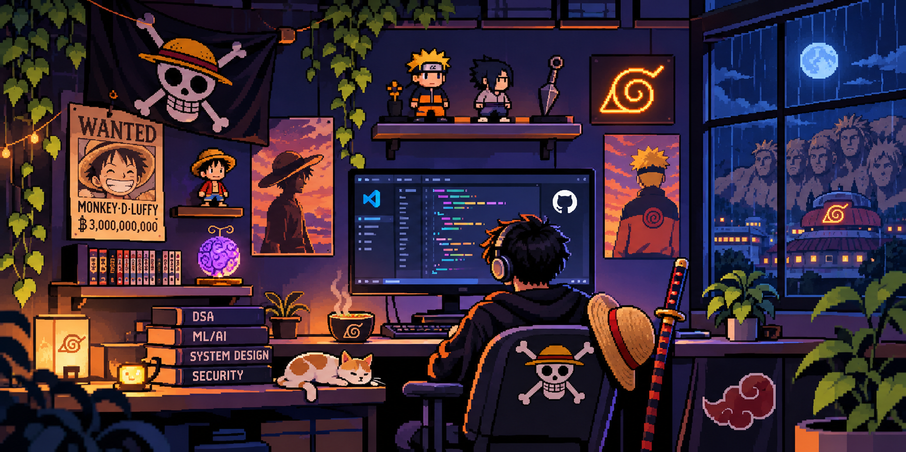

<h1 align="center">Hey, I'm Yash Lowanshi 👋</h1>

<h3 align="center">CSE Student | Aspiring Software Developer</h3>

  Learning, building and exploring the world of technology.

  

 

---

##  About Me:

* 🎓 Computer Science Engineering student at SRM AP.
* 💻 Interested in software development and problem solving.
* 🚀 Learning by building real-world projects.
* 🌱 Always curious about exploring new technologies.

---

##  Technologies & Tools:

### Used in Projects:

  

### Learning:

  

### Planning to Explore:

  

### Tools & Platforms:

  

---

##  Featured Projects:

### 🌱 EcoQuest

An environmental challenge platform encouraging sustainable actions.

### 🤖 KhataAI

A multilingual digital ledger project designed to simplify bookkeeping.

### 🔍 Log Analyzer

A Java-based log analysis and incident detection application.

---

## 🐍 My GitHub Contribution Snake

  

